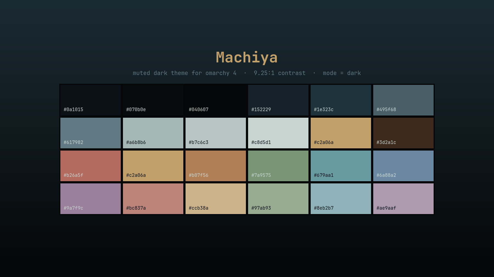

# Machiya

A very dark, cool theme for [Omarchy](https://omarchy.org) 4 (Quattro), named for the
traditional townhouses it was drawn from: a rain-wet Edo street at night, lit only by
paper lanterns.

Teal-black almost everywhere, with a single muted lantern-gold accent. This is the
darkest of the set — the background sits at `#0a1015` and nothing in the palette
shouts.



## Install

```bash
omarchy theme install https://github.com/LizinDev/omarchy-machiya-theme.git
```

## Palette

| Role | Hex | |
|---|---|---|
| background | `#0a1015` | terminals, bar, popups, menus |
| foreground | `#a6b8b6` | all body text — 9.25:1 on background |
| accent | `#c2a06a` | borders, shortcuts, selected rows |
| selection | `#1e323c` | text selection, btop meters |
| muted | `#495f68` | ANSI bright-black, dividers |

ANSI: `#b26a5f` red · `#7a9575` green · `#c2a06a` yellow · `#6a88a2` blue ·
`#9a7f9c` magenta · `#679aa1` cyan.

Cool hues average 0.28 saturation against 0.48 for the warm ones, mirroring the source
image: a cold street with a few warm lights in it. No ANSI pair is closer than 14.7 ΔE,
so terminal output stays readable.

## What's here

| File | |
|---|---|
| `colors.toml` | the palette — generates 17 app configs on its own |
| `hyprland.lua` | gold→teal border gradient + a warm shadow on the focused window |
| `shell.{menu,launcher,tooltip,lock}.toml` | per-section shell overrides |
| `icons.theme` | `Yaru-prussiangreen-dark` |
| `backgrounds/` | a palette-derived gradient (see below) |
| `preview.png` | theme-switcher tile |
| `unlock.png` | Plymouth boot splash and SDDM logo |

## Backgrounds

Only `3-machiya-void.png` ships here — a plain gradient generated from the palette.
The theme was designed against a piece of pixel art, but that is someone else's work
and is not redistributed. Drop your own in:

```bash
cp <your-wallpaper> ~/.config/omarchy/themes/machiya/backgrounds/1-machiya.png
omarchy theme set machiya
```

Backgrounds are picked in plain lexical order; cycle with `Super + Ctrl + Space`.

## Caveats

**Installed from a git clone, this theme loses `hyprland.lua`.** Omarchy drops every
`.lua`, terminal config and `vscode.json` from a cloned theme, because each names
something to run. The palette and the border gradient survive — they live in
`colors.toml` — but not the window shadows.

**`shell.*.toml` overrides replace their whole section, they don't merge.** Each file
here restates the complete section, and its hex values are frozen copies of
`colors.toml`. Re-sync them if you change the palette.

## Working on it

Keep the repo outside `~/.config/omarchy/themes` and symlink it in. A directory with a
`.git` inside is treated as somebody else's theme and staged under restrictions; a
symlink is not.

```bash
git clone <this-repo> ~/Projects/omarchy-machiya-theme
ln -s ~/Projects/omarchy-machiya-theme ~/.config/omarchy/themes/machiya
omarchy theme set machiya
```

Iterate with `omarchy theme refresh`. `omarchy dev theme-preview colors.toml` prints
the neutral ramp and a contrast reading.
